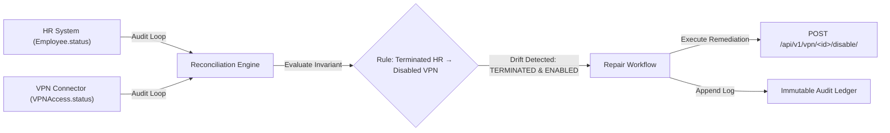

# ReconcileOS

> **A Continuous Integrity and Self-Healing System for Connected Applications**
> *Major Academic Project (B.Tech Computer Science & Engineering)*

---

## 1. What is ReconcileOS?

**ReconcileOS** is an automated continuous integrity and self-healing platform engineered to prevent authorization drift, stale credentials, and unauthorized access across distributed enterprise applications.

In modern organizations, business events occur in primary systems of record (e.g., an employee leaving the company in the HR system), but downstream systems (GitHub, VPN, AWS/Cloud, Slack, Okta) often retain active permissions due to manual delays, webhook drops, or synchronization failures. 

ReconcileOS periodically audits and enforces multi-system business invariants such as:
> *"If an employee is `TERMINATED` in the HR system, that employee must have zero active access across VPN, GitHub, Cloud, and Slack."*

When invariant violations (drifts) are detected, ReconcileOS executes deterministic reconciliation workflows, requests approvals where needed, logs tamper-evident audit trails, and restores system integrity.

---

### 2. Current Architecture (Milestone 2)

ReconcileOS incorporates both the primary HR/Employee system of record and the **simulated downstream VPN connector** under a clean, modular, extensible architecture:

```
reconcileOS/
├── manage.py                          # Django management script
├── requirements.txt                   # Locked production & dev dependencies
├── .env.example                       # Environment configuration template
├── .gitignore                         # Git exclusion rules
├── README.md                          # Project documentation
├── reconcileos/                       # Project root configuration
│   ├── __init__.py
│   ├── settings.py                    # Settings (DRF, JWT, CORS, DB config)
│   ├── urls.py                        # Root API URL routing & health check
│   ├── wsgi.py                        # WSGI entrypoint
│   └── asgi.py                        # ASGI entrypoint
└── apps/                              # Modular domain applications
    ├── __init__.py
    ├── accounts/                      # Authentication & JWT token infrastructure
    │   ├── apps.py
    │   ├── models.py
    │   └── urls.py
    ├── employees/                     # HR System of Record (Milestone 1 Core)
    │   ├── admin.py                   # Django Admin registration & actions
    │   ├── apps.py
    │   ├── models.py                  # Employee model with UUID & lifecycle states
    │   ├── serializers.py             # DRF serializers & field validators
    │   ├── views.py                   # ViewSets & explicit action endpoints
    │   ├── urls.py                    # Employees REST API routes
    │   ├── tests.py                   # 13 automated unit & integration tests
    │   ├── migrations/                # Database migrations
    │   └── management/commands/       # Custom commands (seed_employees)
    ├── connectors/                    # Downstream Connectors (Milestone 2 Core)
    │   ├── admin.py                   # Django Admin registration & bulk actions
    │   ├── apps.py
    │   ├── models.py                  # VPNAccess model with OneToOne binding & transitions
    │   ├── serializers.py             # VPNAccess DRF serializers & nested contexts
    │   ├── views.py                   # ViewSets with auto-initialization & enable/disable actions
    │   ├── urls.py                    # VPN connector REST API routes
    │   ├── tests.py                   # 15 automated unit & integration tests
    │   └── migrations/                # Database migrations (0001_initial.py)
    ├── rules/                         # [Scaffolded] Invariant rule definition engine
    ├── reconciliation/                # [Scaffolded] Drift detection & state comparison engine
    ├── workflows/                     # [Scaffolded] Remediation & self-healing state machine
    ├── approvals/                     # [Scaffolded] Human-in-the-loop approval workflows
    └── audit/                         # [Scaffolded] Immutable event & reconciliation logs
```

---

## 3. Technology Stack

- **Backend Framework**: Python 3.14+ / Django 5.1.x
- **API Engine**: Django REST Framework (DRF) 3.17.x
- **Authentication**: SimpleJWT (JSON Web Tokens) & Django Session Auth
- **Database**: SQLite (default for development), PostgreSQL-ready via `DB_ENGINE` configuration
- **CORS & Filters**: `django-cors-headers`, `django-filter`
- **Testing**: Django Test Suite & DRF `APITestCase` (28 automated tests)

---

## 4. How to Install Dependencies

### Step 1: Clone the repository & navigate to project root
```bash
git clone <repo-url>
cd reconcileOS
```

### Step 2: (Optional but recommended) Create and activate a virtual environment
```powershell
# Windows (PowerShell)
python -m venv venv
.\venv\Scripts\Activate.ps1

# Linux / macOS
python3 -m venv venv
source venv/bin/activate
```

### Step 3: Install dependencies
```bash
pip install -r requirements.txt
```

### Step 4: Configure environment variables
Copy the template configuration file:
```powershell
# Windows (PowerShell)
Copy-Item .env.example .env

# Linux / macOS
cp .env.example .env
```

---

## 5. How to Run Migrations & Seed Sample Data

### Run database migrations
```bash
python manage.py makemigrations employees accounts connectors
python manage.py migrate
```

### (Optional) Seed realistic demo employees
```bash
python manage.py seed_employees
```

### Seed Demonstration Scenario (Authorization Drift State)
To initialize the first ReconcileOS demonstration scenario (Rahul Kumar: HR `TERMINATED` vs VPN `ENABLED`):
```bash
python manage.py seed_demo_drift
```

### (Optional) Create superuser for Django Admin
```bash
python manage.py createsuperuser
```

---

## 6. How to Run the Django Development Server

Start the development server at `http://127.0.0.1:8000/`:

```bash
python manage.py runserver
```

---

## 7. Simulated VPN Connector & API Reference

### Purpose & Architecture
The **Simulated VPN Connector** maintains the current VPN access state for enterprise employees within downstream network infrastructure. Rather than managing complex third-party VPN hardware at this stage, this connector exposes an API-driven abstraction that records whether an employee has `ENABLED` or `DISABLED` network access.

### Zero-Trust Default State Rationale
When an existing employee is queried via `GET /api/v1/vpn/<employee_id>/` or acted upon via `enable` / `disable` without a prior VPN record, the system **auto-initializes** the record with status **`DISABLED`**.
> **Why `DISABLED` by default?**
> In enterprise security and Zero-Trust architecture (Least Privilege Default), an employee must not possess open network ingress until explicitly and intentionally provisioned. Default-deny prevents accidental exposure of internal infrastructure.

### Database-Level Integrity
Each employee has **exactly one** VPN access record, enforced via a `OneToOneField` at the database level (`apps_connectors_vpnaccess.employee_id UNIQUE`), preventing duplicate or conflicting states.

---

### Available API Endpoints

#### System Endpoints
| Method | Endpoint | Description |
|---|---|---|
| `GET` | `/api/v1/health/` | Service health status & active module registry |
| `GET` | `/admin/` | Django Admin Dashboard |

#### Authentication Endpoints (JWT)
| Method | Endpoint | Description |
|---|---|---|
| `POST` | `/api/v1/auth/token/` | Obtain JWT access & refresh token pair |
| `POST` | `/api/v1/auth/token/refresh/` | Refresh expired access token |
| `POST` | `/api/v1/auth/token/verify/` | Verify token validity |

#### Employee / HR System Endpoints
| Method | Endpoint | Description |
|---|---|---|
| `GET` | `/api/v1/employees/` | List all employees (paginated, filterable, searchable) |
| `POST` | `/api/v1/employees/` | Create a new employee |
| `GET` | `/api/v1/employees/<uuid:id>/` | Retrieve details for a single employee |
| `PUT` | `/api/v1/employees/<uuid:id>/` | Full update of employee details |
| `PATCH` | `/api/v1/employees/<uuid:id>/` | Partial update of employee details |
| `DELETE` | `/api/v1/employees/<uuid:id>/` | Remove employee record |
| `POST` | `/api/v1/employees/<uuid:id>/terminate/` | **Explicit action**: Terminate employee |

#### Simulated VPN Connector Endpoints
| Method | Endpoint | Description |
|---|---|---|
| `GET` | `/api/v1/vpn/` | List all VPN access records (paginated, filterable, searchable) |
| `GET` | `/api/v1/vpn/<uuid:employee_id>/` | Retrieve VPN state (auto-initializes to `DISABLED` if not present) |
| `POST` | `/api/v1/vpn/<uuid:employee_id>/enable/` | **Explicit action**: Enable VPN access for employee |
| `POST` | `/api/v1/vpn/<uuid:employee_id>/disable/` | **Explicit action**: Disable VPN access for employee |

#### Invariant Rule Engine Endpoints
| Method | Endpoint | Description |
|---|---|---|
| `GET` | `/api/v1/rules/` | List invariant rules (paginated, filterable by `is_enabled`, `severity`, `source_system`, `target_system`) |
| `POST` | `/api/v1/rules/` | Create a new multi-system invariant rule |
| `GET` | `/api/v1/rules/<uuid:id>/` | Retrieve invariant rule details and formal expression |
| `PUT` | `/api/v1/rules/<uuid:id>/` | Full update of invariant rule definition |
| `PATCH` | `/api/v1/rules/<uuid:id>/` | Partial update of invariant rule definition |
| `DELETE` | `/api/v1/rules/<uuid:id>/` | Remove invariant rule |
| `POST` | `/api/v1/rules/<uuid:id>/toggle/` | **Explicit action**: Toggle rule active status (`is_enabled`) |

#### State Collection Layer Endpoints
| Method | Endpoint | Description |
|---|---|---|
| `GET` | `/api/v1/reconciliation/state/` | Collect multi-system state for all employees |
| `GET` | `/api/v1/reconciliation/state/<employee_id>/` | Collect multi-system identity state for a specific employee |

---

### Example API Requests & Responses

#### 1. Retrieve VPN State (with Zero-Trust Auto-Initialization)
**Request:**
```http
GET /api/v1/vpn/c2841bcf-3321-4617-bafc-27c0c22abdc3/ HTTP/1.1
```
*Curl equivalent:*
```bash
curl -X GET http://127.0.0.1:8000/api/v1/vpn/c2841bcf-3321-4617-bafc-27c0c22abdc3/
```

**Response (`200 OK`):**
```json
{
  "id": "d590f791-7fa0-4024-ae3a-1e89d690df69",
  "employee": "c2841bcf-3321-4617-bafc-27c0c22abdc3",
  "employee_id": "c2841bcf-3321-4617-bafc-27c0c22abdc3",
  "employee_email": "elena.rostova@company.com",
  "employee_name": "Elena Rostova",
  "employee_department": "Platform Engineering",
  "employee_status": "ACTIVE",
  "status": "DISABLED",
  "status_display": "Disabled",
  "created_at": "2026-08-18T13:17:30.287180Z",
  "updated_at": "2026-08-18T13:17:30.287204Z"
}
```

#### 2. Explicitly Enable VPN Access
**Request:**
```http
POST /api/v1/vpn/c2841bcf-3321-4617-bafc-27c0c22abdc3/enable/ HTTP/1.1
```
*Curl equivalent:*
```bash
curl -X POST http://127.0.0.1:8000/api/v1/vpn/c2841bcf-3321-4617-bafc-27c0c22abdc3/enable/
```

**Response (`200 OK`):**
```json
{
  "status": "success",
  "message": "VPN access enabled successfully.",
  "status_changed": true,
  "action": "ENABLE",
  "vpn_access": {
    "id": "d590f791-7fa0-4024-ae3a-1e89d690df69",
    "employee": "c2841bcf-3321-4617-bafc-27c0c22abdc3",
    "employee_id": "c2841bcf-3321-4617-bafc-27c0c22abdc3",
    "employee_email": "elena.rostova@company.com",
    "employee_name": "Elena Rostova",
    "employee_department": "Platform Engineering",
    "employee_status": "ACTIVE",
    "status": "ENABLED",
    "status_display": "Enabled",
    "created_at": "2026-08-18T13:17:30.287180Z",
    "updated_at": "2026-08-18T13:17:30.298748Z"
  }
}
```

#### 3. Explicitly Disable VPN Access
**Request:**
```http
POST /api/v1/vpn/c2841bcf-3321-4617-bafc-27c0c22abdc3/disable/ HTTP/1.1
```
*Curl equivalent:*
```bash
curl -X POST http://127.0.0.1:8000/api/v1/vpn/c2841bcf-3321-4617-bafc-27c0c22abdc3/disable/
```

**Response (`200 OK`):**
```json
{
  "status": "success",
  "message": "VPN access disabled successfully.",
  "status_changed": true,
  "action": "DISABLE",
  "vpn_access": {
    "id": "d590f791-7fa0-4024-ae3a-1e89d690df69",
    "employee": "c2841bcf-3321-4617-bafc-27c0c22abdc3",
    "employee_id": "c2841bcf-3321-4617-bafc-27c0c22abdc3",
    "employee_email": "elena.rostova@company.com",
    "employee_name": "Elena Rostova",
    "employee_department": "Platform Engineering",
    "employee_status": "ACTIVE",
    "status": "DISABLED",
    "status_display": "Disabled",
    "created_at": "2026-08-18T13:17:30.287180Z",
    "updated_at": "2026-08-18T13:17:30.309016Z"
  }
}
```

#### 4. List All VPN Access Records
**Request:**
```http
GET /api/v1/vpn/?status=ENABLED HTTP/1.1
```
*Curl equivalent:*
```bash
curl -X GET "http://127.0.0.1:8000/api/v1/vpn/?status=ENABLED"
```

**Response (`200 OK`):**
```json
{
  "count": 1,
  "next": null,
  "previous": null,
  "results": [
    {
      "id": "d590f791-7fa0-4024-ae3a-1e89d690df69",
      "employee": "c2841bcf-3321-4617-bafc-27c0c22abdc3",
      "employee_id": "c2841bcf-3321-4617-bafc-27c0c22abdc3",
      "employee_email": "elena.rostova@company.com",
      "employee_name": "Elena Rostova",
      "employee_department": "Platform Engineering",
      "employee_status": "ACTIVE",
      "status": "ENABLED",
      "status_display": "Enabled",
      "created_at": "2026-08-18T13:17:30.287180Z",
      "updated_at": "2026-08-18T13:17:30.298748Z"
    }
  ]
}
```

---

## 8. Role in the Reconciliation System (Upcoming Milestones)

In subsequent milestones, ReconcileOS will connect the HR system (`apps.employees`) with the VPN system (`apps.connectors`) through an automated reconciliation loop:



---

## 9. What Has Been Implemented (Milestones 1 & 2)

- [x] **Project Architecture**: Modular Django layout with `apps/` separation.
- [x] **Authentication Foundation**: SimpleJWT token obtain, refresh, and verify endpoints.
- [x] **HR Employee Model & APIs (Milestone 1)**:
  - UUIDv4 primary keys, `ACTIVE`/`TERMINATED` lifecycle states
  - Full CRUD endpoints + explicit `POST /terminate/` action
  - 13 automated unit & integration tests
- [x] **Simulated VPN Connector (Milestone 2)**:
  - `VPNAccess` model with `OneToOneField` DB-level uniqueness constraint
  - Zero-Trust default policy (`DISABLED` auto-initialization)
  - Explicit action endpoints: `POST /enable/` and `POST /disable/`
  - Employee ID lookup with full 404 validation for invalid IDs
  - Django Admin interface with bulk enable/disable actions
  - 15 automated unit & integration tests (Total test suite: 28 tests, 100% passing)

---

## 10. What Will Be Implemented Next (Roadmap)

- **Milestone 3**: Business Rules Engine & Invariant Definition
  - Rule model and validator for *"Terminated HR → Disabled VPN Access"*
- **Milestone 4**: Continuous Reconciliation Engine
  - Periodic polling & drift detection algorithms (identifying invariant violations)
  - Discrepancy reporting and mismatch alerting
- **Milestone 5**: Self-Healing & Remediation Workflows
  - Automated repair executor with retry mechanics and fallback
  - Human-in-the-loop approval workflow for high-risk operations
- **Milestone 6**: Audit Ledger & Event Log
  - Immutable audit trail of every detection, approval, and repair action
- **Milestone 7**: React + Vite Dashboard Frontend
  - Live integrity status, manual drift inspection, and 1-click healing interface

