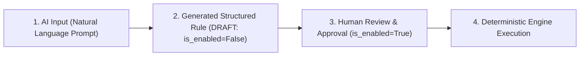

# ReconcileOS AI-Assisted Rule Creation Architecture

## Overview
ReconcileOS provides an optional, isolated AI-assisted rule generation feature. It allows security administrators to input natural-language policy requirements and converts them into proposed structured invariant rules in **DRAFT** state (`is_enabled=False`).

---

## Safety & Security Principles

> [!IMPORTANT]
> 1. **Zero Direct Execution**: The AI component **NEVER** executes remediation actions.
> 2. **Zero Direct System Mutation**: The AI component **NEVER** modifies downstream connected systems (VPN, GitHub, Cloud IAM, Slack).
> 3. **No Approval Bypassing**: Generated rules are persisted strictly with `is_enabled=False` (DRAFT status). They cannot be evaluated by the reconciliation engine until an administrator inspects and explicitly activates them.
> 4. **Isolated Fallback Architecture**: The AI generator is completely decoupled from the core deterministic reconciliation engine. If the AI component fails or is offline, core ReconcileOS functionality operates without disruption.

---

## 4-Phase AI Rule Lifecycle



### Phase 1: AI Input
An administrator submits a natural language policy requirement via REST API endpoint `POST /api/v1/rules/generate_draft/`.

**Example Input Prompt:**
```text
"Terminated employees must not have access to company systems."
```

### Phase 2: Generated Structured Rule (DRAFT State)
The `AIRuleGenerator` service parses the requirement and extracts structured invariant parameters matching the ReconcileOS rule schema. The rule is created with `is_enabled=False`.

**Generated Rule Output:**
```json
{
    "status": "success",
    "message": "AI draft rule 'AI-DRAFT-F3A912' created successfully. Requires human administrator review and activation.",
    "is_enabled": false,
    "human_review_required": true,
    "rule": {
        "id": "e4d7a829-1234-4567-89ab-cdef01234567",
        "rule_code": "AI-DRAFT-F3A912",
        "name": "AI Proposed: VPN Invariant (TERMINATED -> DISABLED)",
        "description": "AI-generated draft invariant rule derived from administrator prompt: \"Terminated employees must not have access to company systems.\". Requires explicit human administrator review and activation before evaluation.",
        "source_system": "HR",
        "condition_attribute": "status",
        "condition_value": "TERMINATED",
        "target_system": "VPN",
        "expected_attribute": "status",
        "expected_value": "DISABLED",
        "severity": "CRITICAL",
        "is_enabled": false,
        "rule_expression": "WHEN HR.status == 'TERMINATED' THEN EXPECT VPN.status == 'DISABLED'"
    }
}
```

### Phase 3: Human Review & Approval
The administrator reviews the generated draft rule in the ReconcileOS interface or via API.
- The administrator can modify fields (e.g. adjust severity, change target system, update description).
- To activate the rule, the administrator explicitly triggers `POST /api/v1/rules/<rule_id>/toggle/` to transition `is_enabled` from `False` to `True`.

### Phase 4: Deterministic Execution
The core `ReconciliationEngine` queries `Rule.objects.filter(is_enabled=True)`.
- Only approved/enabled rules are evaluated against multi-system state.
- Invariant evaluation, drift detection, repair planning, human approval, execution, and empirical post-repair verification are performed entirely by deterministic services.
